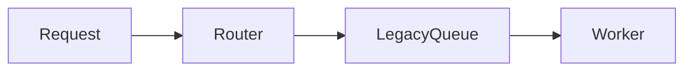

# Writing in Rob's voice

## Explicit conventions

Rob requires conventional PR titles and commit messages: `type(scope): summary`, with a standard type and a meaningful affected-domain scope when one is evident, such as `feat(router): add legacy queue routing`. Use `feat`, not `feature`; follow repository scope conventions. The body must explain the same change as the title in normal prose under the chosen template. New branches use `rob/<descriptive-change-slug>` without routine randomness or a separate agent prefix. Use a meaningful qualifier or small suffix only for a collision with different work. Existing branches keep their names.

Follow each repository's tracker and PR link conventions. Include full links to known related tickets or issues, normally expected for tracked work. GitHub Issues, Jira, Asana, and Linear are possible; no tracker or host is a global default. Use `/task <full Jira ticket URL>` only where repository instructions require it. Otherwise use the repository's format or descriptive Markdown links. Do not invent links or require ticket creation for every PR. Flag an unresolved key rather than guessing its URL, and omit ticket lines when no related work is known.

A PR title can optionally append a real related ticket key in square brackets: `feat(auth): add session renewal [EXAMPLE-123]` is a synthetic illustration. Use a key supplied or verified for the actual change, never one copied from an example. Titles without a suffix are equally valid. The suffix supplements, and does not replace, the full related-ticket or issue link in the body.

Lead the substantive description with **“This change will…”** and the concrete outcome of applying or merging the change. Follow it with the impetus: why the work is needed now, whether it fixes a bug, prepares another change, or advances a larger sequence. Use actual evidence; if the impetus is missing, say that it is not documented. These are explicit current preferences and take precedence over older examples.

Always preserve the target repository's PR template and its requirements. With no repository template, use [the bundled default](../assets/default-pr-template.md). Its core sections are Summary of changes, Why, and Testing Done. Related work, Rollout and risks, and Details are conditional. The fallback sections are chosen defaults, open to later iteration.

## Observed tendencies

A sample of PRs authored by Rob in 2024 used short, practical explanations. Small changes commonly began with “This change…” or “This adjusts…”, then named the behavior and its reason. More involved changes explained the cause and a meaningful implementation choice in a few paragraphs. First person appeared when explaining a decision.

Retain the direct, practical level of detail while using Rob's current required opening. Use concrete names when they help the reviewer. The older recurring summary/testing labels may partly reflect repository templates; they do not override the current template or explicit preferences.

## GitHub Markdown

Rob encourages liberal, purposeful use of GitHub-flavored Markdown for **structure, glanceability, and comprehensibility**. Use headings allowed by the template, emphasis for key outcomes, code formatting for identifiers, lists for parallel points, and task lists with honest completion states. Choose richer formatting whenever it helps a reviewer scan or understand the change:

- **Tables:** compare before/after behavior, alternatives, compatibility, or validation results. Use descriptive column headers and a blank line before the table. Keep small comparisons visible; put long sample tables in Details.
- **Alerts/notices:** use `> [!NOTE]`, `> [!IMPORTANT]`, or `> [!WARNING]` for a real consequence, dependency, or action the reader needs to notice. Put the message on following `>` lines. Keep alerts visible and outside lists or collapsible sections. Match their prominence to the facts.
- **Collapsible details:** put lengthy logs, sample data, or supplemental reasoning in `<details>` with a descriptive `<summary>` near the end of the relevant section or body. Keep blank lines around the Markdown inside. The primary outcome, rationale, test-result summary, and material risks stay visible above the fold.
- **Diagrams:** use a fenced `mermaid` block when a flow, dependency, state transition, or before/after comparison explains the change more clearly. Label what changes and what is only planned. Draw only relationships established by the evidence; a simple copy edit needs no diagram.
- **Citations:** place descriptive inline links beside claims they support, using real issues, design documents, code permalinks, or test/CI output actually inspected or supplied. For example, the claim that GitHub supports diagrams in PR bodies can link to [GitHub's diagram documentation](https://docs.github.com/en/get-started/writing-on-github/working-with-advanced-formatting/creating-diagrams). Check that each source supports that claim; prefer a stable commit permalink for code. If a source cannot be verified, identify that limitation rather than inventing a URL or treating it as verified evidence. Preserve repository-required ticket syntax, including `/task` when required, in addition to explanatory citations.

Use ordinary `[descriptive label](https://...)` links for citations in PR bodies. Do not copy tool-specific citation tokens into GitHub or assume a feature supported in README files, wikis, or other surfaces works in PR descriptions. Verify unfamiliar syntax against GitHub's PR-body support or a rendered preview before relying on it.

All formatting stays within the repository template's structure and restrictions. If it prohibits HTML or diagrams, explain the same facts in the allowed prose, lists, or tables. Formatting must not invent measurements, risks, or implementation details.

Synthetic formatting examples (adapt to the actual change):

````markdown
> [!IMPORTANT]
> Deploy the router before enabling the routing flag.



<details>
<summary>Routing samples</summary>

| Sample | Before | After |
| --- | --- | --- |
| A | legacy | legacy |

</details>
````

GitHub references: [links and citations](https://docs.github.com/en/get-started/writing-on-github/getting-started-with-writing-and-formatting-on-github/basic-writing-and-formatting-syntax#links), [tables](https://docs.github.com/en/get-started/writing-on-github/working-with-advanced-formatting/organizing-information-with-tables), [alerts](https://docs.github.com/en/get-started/writing-on-github/getting-started-with-writing-and-formatting-on-github/basic-writing-and-formatting-syntax#alerts), [collapsed sections](https://docs.github.com/en/get-started/writing-on-github/working-with-advanced-formatting/organizing-information-with-collapsed-sections), and [diagrams](https://docs.github.com/en/get-started/writing-on-github/working-with-advanced-formatting/creating-diagrams).

## Limits of the evidence

GitHub authorship does not prove who composed every sentence. Recent examples included explicit automation attribution and bot summaries; those were not treated as evidence of Rob's personal voice. Older empty ticket placeholders and repository-specific commands are not portable conventions.

Private source text and internal links are intentionally absent. Use the observed level of detail, not proprietary content. Testing notes should include actual outcomes even when older examples named only a test framework.

## Synthetic small-change example

Title: `fix(cache): skip expired cache entries`

Optional title for this same synthetic ticket: `fix(cache): skip expired cache entries [APP-42]`.

```markdown
## Summary of changes

This change will skip expired cache entries so readers no longer receive stale results.

## Why

The ticket's reproduction shows that reads after the TTL still return expired values.

## Related work

[APP-42](https://example.atlassian.net/browse/APP-42)

## Testing Done

`pytest tests/test_cache.py` — 12 passed.
```

The ticket, behavior, and test result above are illustrative, not reusable facts. This example has no repository-specific ticket syntax. If repository instructions require it, use `/task https://example.atlassian.net/browse/APP-42` instead. For a GitHub issue, a descriptive full link such as `[Cache expiry issue](https://github.com/example/cache/issues/42)` is appropriate unless the repository specifies another format. A related link alone does not authorize automatic issue closure.
